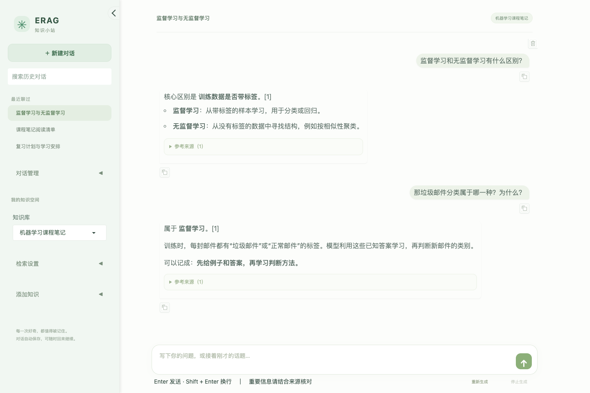

# ERAG · 知识小站

把教材、讲义和笔记变成可以提问、持续追问、核对原文的知识库。

ERAG 是面向教学资料的 RAG 问答项目：先从你提供的资料中查找相关内容，再组织回答并展示参考来源。网页会保存对话，方便下一次继续学习；支持本地 Qwen3 和 OpenAI-compatible 模型服务。



*本地运行的网页截图；课程资料与问答为预置的文档演示内容，不是模型效果评测。*

## 你可以用 ERAG 做什么

| 你的任务 | 如何使用 | 可以得到什么 |
|---|---|---|
| 读懂一份教材或讲义 | 上传 PDF、TXT、Markdown 或 CSV，构建知识库后提问 | 基于资料的解释，以及可展开核对的原文片段 |
| 比较概念、继续追问 | 在同一对话里接着问“它有什么区别”“能举个例子吗” | 结合前文理解当前问题的多轮问答 |
| 分别整理不同学习主题 | 新建对话，选择对应知识库，搜索或重命名历史 | 可恢复的聊天记录，以及包含来源的 Markdown 导出 |
| 调整资料检索方式 | 在左侧开关重排和补充检索（TCT） | 按会话保存的检索设置，便于针对自己的资料比较效果 |

**第一次使用的路径：** 添加知识 → 选择知识库 → 提问与追问 → 展开参考来源 → 保存或导出对话。也可以选择“普通聊天”，直接与模型交谈。

查看 [网页功能图文指南](docs/chat-workspace.md)，按截图了解上传资料、查看来源、历史管理和检索设置。

## 快速开始

准备 Python 3.11+，获取项目并安装：

```bash
git clone https://github.com/ganchun1130/ERAG.git
cd ERAG
python3 -m venv .venv
source .venv/bin/activate
pip install -e '.[resources]'
cp .env.example .env
```

编辑 `.env`，连接你自己的模型服务。网页本身不包含模型推理服务：

| 使用方式 | 需要配置的服务 |
|---|---|
| 普通聊天 | LLM 的地址、模型名和 API Key |
| 上传资料并进行知识库问答 | LLM + Embedding；建库和查询使用同一 Embedding 配置 |
| 开启“重排检索结果” | 在上述配置基础上增加 Reranker；暂时没有时设 `ERAG_RERANK_ENABLED=false` |

具体字段见 [配置模板](.env.example)。使用自己的本地 GPU 模型时，先按 [部署指南](docs/deployment.md) 启动模型服务，再启动网页：

```bash
erag-ui
```

打开 <http://127.0.0.1:7860>，通过左侧“添加知识”上传自己的资料。仓库不预置截图中的教材、知识库或对话；启动后会自动保存你创建的会话和知识库。

也可以使用命令行：

```bash
erag build --name 我的资料 /path/to/教材.pdf
erag list
erag ask --kb 我的资料 '这份资料的主要观点是什么？'
```

CLI 的 `ask` 是单次请求；网页负责保存持续历史，Python API 可显式传入 `history`。

## 本地模型

资源下载器默认只下载三个模型，使用 [固定版本清单](erag/resource-manifest.json)：

```bash
erag-download --dry-run
erag-download
erag-download --only embedding reranker  # 使用云端 LLM 时可只下载检索模型
```

模型默认位于 `resources/models/`。GPU 环境安装与服务启动见 [部署指南](docs/deployment.md)，资源目录和可选数据下载见 [资源指南](docs/resources.md)。

```bash
erag-server
# 服务启动后，在另一个终端加载模型：
erag-models --resources-root resources --llm-gpu 0 --embedding-gpu 1 --reranker-gpu 2
erag-check --env-file .env
```

## 核心配置

`.env` 使用 `ERAG_` 前缀，环境变量优先，路径相对于启动目录。

| 配置 | 默认 / 用途 |
|---|---|
| `RETRIEVAL_MODE` | `raw` 原文；还支持 `dual` 摘要/标签、`hybrid` 向量/BM25 |
| `PER_QUERY_TOP_K` / `FINAL_TOP_K` | `50` / `5` |
| `RERANK_ENABLED` | `true`，对候选证据重排 |
| `CONTEXTUAL_RANKING` | `true`，结合历史补全当前检索问题 |
| `TCT_ENABLED` / `TCT_MODE` | `false` / `focused`；按需开启补充检索 |
| `ENRICH_ENABLED` | `false`；开启后生成摘要与标签 |
| `HISTORY_TURNS` / `HISTORY_MAX_CHARS` | `5` / `12000` |
| `CONTEXT_MAX_CHARS` | `16000`，按完整知识块打包 |
| `KNOWLEDGE_BASE_ROOT` | `./data/knowledge_bases` |
| `CHUNK_MAX_CHARS` / `CHUNK_OVERLAP` | `900` / `120` |

使用摘要/标签路线时，设置 `ERAG_RETRIEVAL_MODE=dual`、`ERAG_ENRICH_ENABLED=true` 并重新建库。Embedding 模型、revision 或指令变化后应重建索引。重排和 TCT 的收益取决于资料与问题，TCT 默认关闭；可以在网页中按需尝试。

## 使用边界

- 扫描版 PDF 需要先做 OCR；当前不恢复复杂公式和表格结构。
- 参考来源便于核对，但有引用编号不代表回答中的每条论断都正确。
- 对话按浏览器保存关联；当前没有账户系统或跨浏览器同步。网页默认仅供本机访问，公开部署需自行增加认证。
- 回答生成完成后一次显示正文，当前不逐字输出；“停止生成”会停止本轮等待和写回，模型端请求可能仍继续执行。

## 项目结构

```text
erag/                   # 问答引擎、知识库、模型适配、网页与服务入口
benchmarks/             # 数据准备、检索/多轮评测、消融与汇总代码
tests/                  # 无需模型服务的自动化测试
config/                 # 部署配置模板和依赖版本
scripts/                # 远程 conda 环境启动辅助脚本
docs/                   # 网页图文指南、截图、架构、部署与资源说明
.github/workflows/      # GitHub 自动检查
```

[架构说明](docs/architecture.md) 描述各模块职责。知识库、聊天历史、模型权重和缓存按需生成，不提交 Git。

## 开发与评测代码

```bash
pip install -e '.[dev]'
pytest -q
ruff check .
ruff format --check .
python -m pip check
```

`benchmarks/` 保留评测能力，不附带历史结果和测试集。各入口使用 `python -m benchmarks.<模块> --help` 查看参数。课程验证必须用 `--fixture` 或 `--fixture-dir` 显式指定包含 `course.md` 与 `cases.json` 的自备数据；公共数据可按需下载：

```bash
erag-download --only retrieval-data retrieval-labels mtrag
python -m benchmarks.prepare_t2_fixture --help
python -m benchmarks.prepare_mtrag --help
python -m benchmarks.expanded_retrieval --help
python -m benchmarks.evaluate_dialogues --help
```

## 许可证

MIT；模型、第三方数据及服务遵守各自许可证与条款。
