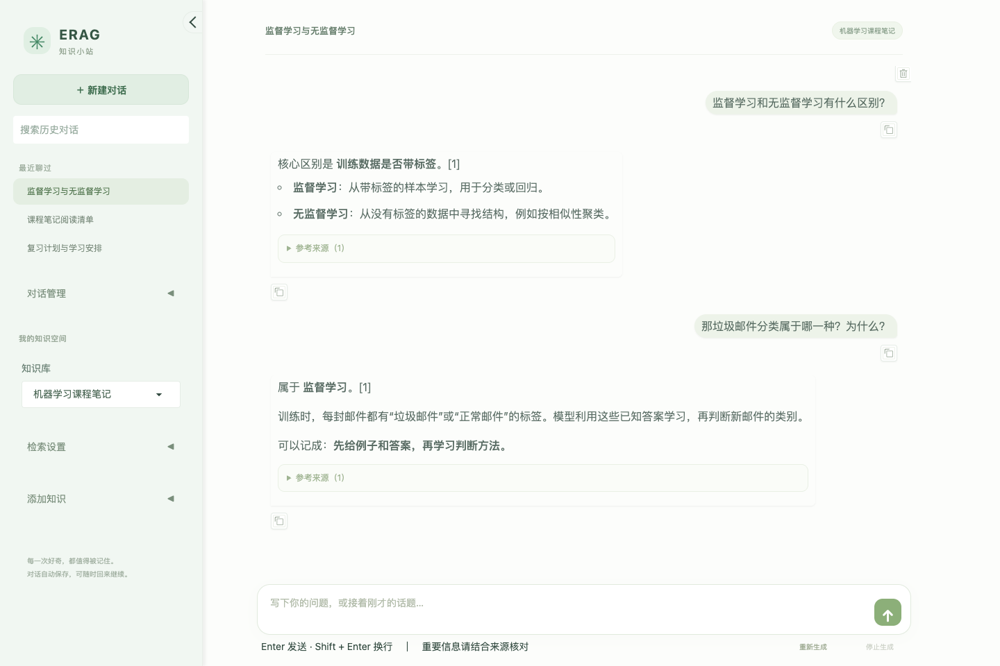
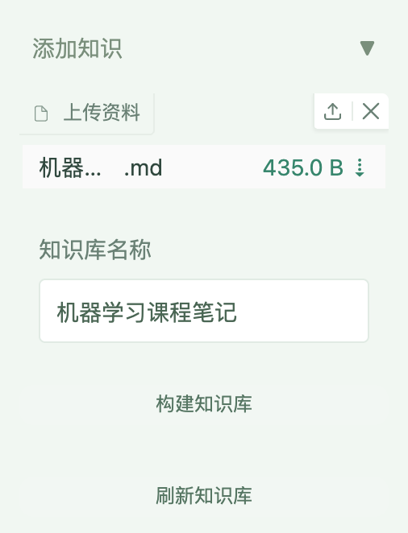
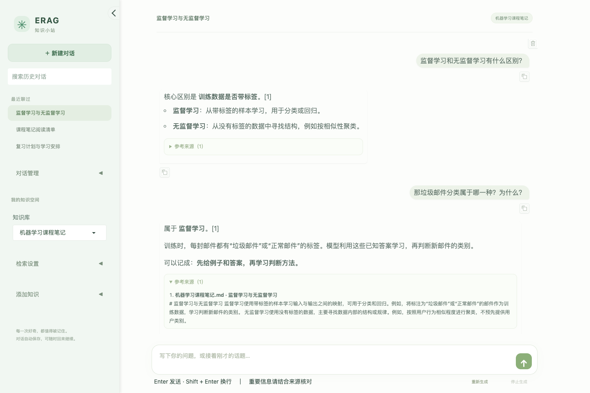
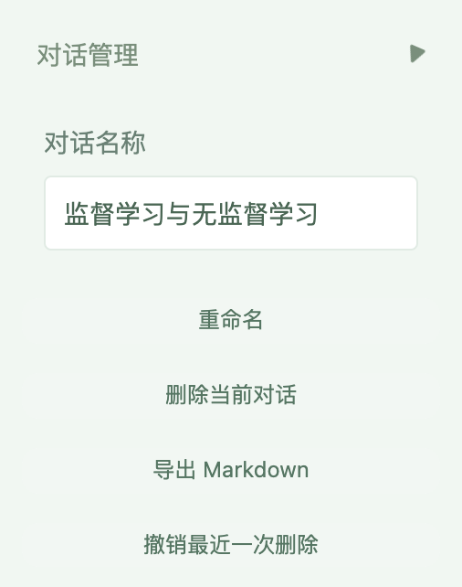
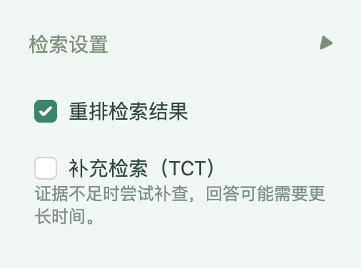

# 网页功能图文指南

ERAG 的使用过程是：把自己的资料放进知识库，围绕资料提问和追问，再打开来源核对答案。左侧管理学习资料与对话，右侧完成问答。

先按 [README](../README.md#快速开始) 配置模型服务并运行 `erag-ui`，打开 <http://127.0.0.1:7860>。远程部署的访问方式见 [部署指南](deployment.md)。

本文截图来自本地运行的网页。截图中的课程资料与问答是为说明操作而预置的演示内容，不是实时模型回答或效果评测；新安装的项目从空知识库、空历史开始。

## 1. 认识工作台

| 位置 | 可以做什么 |
|---|---|
| 左上「新建对话」与「最近聊过」 | 开始一个新主题，或回到之前的聊天；搜索框按对话标题筛选 |
| 左侧「我的知识空间」 | 选择知识库、上传新资料，以及调整检索设置 |
| 右侧聊天区 | 查看问答和参考来源，在底部输入框继续追问 |
| 左侧「对话管理」 | 重命名、导出、删除与撤销删除 |

## 2. 上传资料，建立自己的知识库

1. 展开左侧 **添加知识**，选择一个或多个 PDF、TXT、Markdown 或 CSV 文件。
2. 填写容易辨认的 **知识库名称**，例如“机器学习课程笔记”。
3. 点击 **构建知识库**，等待出现“已完成”与知识块数量。构建过程会读取、切分资料并生成检索索引，需要可用的 Embedding 服务。
4. 完成后，界面自动选中新知识库；也可以通过 **知识库** 下拉框选择已有资料库。其他入口新建的库可通过 **刷新知识库** 加载。

一个知识库可以包含多份相关资料。开始时建议用一份较短、文字清晰的材料，提问一个能直接在原文中找到答案的问题，确认模型服务和资料解析正常。

扫描版 PDF 请先做 OCR；当前不负责复杂公式识别和表格结构恢复。截图展示上传界面，实际建库耗时与文件大小、模型服务有关。

## 3. 连续提问，并核对回答依据

选中知识库后，在右侧输入问题。例如，先问“监督学习和无监督学习有什么区别？”，再接着问“那垃圾邮件分类属于哪一种？为什么？”。系统会结合已完成的问答理解当前问题，再查找本轮需要的资料。

回答带有 `[1]`、`[2]` 等来源编号时，展开回答下方的 **参考来源**，可以查看对应资料的文件名、章节和原文片段；PDF 在解析到页码时还会显示页码。来源编号只对应当前这条回答。

先核对原文是否支持结论，再使用答案。资料中没有的信息可能无法回答；引用存在也不代表每一句话都正确。

| 聊天操作 | 使用方式 |
|---|---|
| 发送与换行 | Enter 发送；Shift + Enter 换行 |
| 复制回答 | 使用回答旁的复制按钮 |
| 重新生成 | 重新回答最后一个问题，替换该轮原回答 |
| 停止生成 | 结束本轮等待，恢复输入，阻止迟到结果写回对话 |

当前会先显示生成状态，完成后一次显示正文，不是逐字输出。停止网页中的生成不等于立即取消模型端计算。

## 4. 管理历史，调整检索设置

### 让不同主题保持独立

- 点击 **新建对话** 开始独立上下文；当前选择的知识库和检索设置会沿用到新对话。
- 点击 **最近聊过** 中的标题恢复聊天；搜索框按标题查找，首个问题默认成为标题。
- 在 **对话管理** 中修改名称并点击 **重命名**，例如把问题标题改为“期末复习：监督学习”。
- 点击 **导出 Markdown** 下载当前对话，文件包含问答和引用原文，便于整理笔记。
- **删除当前对话** 会从历史列表移除该会话；误删后可点击 **撤销最近一次删除** 恢复。

已有消息时切换到其他知识库，会自动建立新对话，原会话仍保留在历史中。

### 按问题需要调整检索

| 设置 | 作用与使用建议 |
|---|---|
| 重排检索结果 | 用 Reranker 对召回的候选资料重新排序，优先提供更相关的证据；需要配置相应模型服务，默认开启 |
| 补充检索（TCT） | 初次证据不足时尝试补查，适合需要补充信息的问题；会增加调用与等待时间，默认关闭 |

两项设置按会话保存。可以针对同一个问题调整设置，再点击 **重新生成** 比较答案和来源；这会替换最后一轮回答，需要保留两版时先导出对话。开关更多并不保证效果更好，应以自己的资料、问题和原文核对结果为准。

### 普通聊天与知识库问答

选择 **普通聊天** 时，不检索上传的资料，适合一般交流；选择具体知识库后，系统可以基于该库查找证据。需要核对课程内容时，应先确认顶部和左侧显示的是正确的知识库。

## 5. 下次回来继续聊

在同一浏览器、同一站点地址下重新打开网页，可以从历史列表继续对话。会话保存在服务器，浏览器保存访问这些会话所需的标识；清除站点数据或更换浏览器，会失去原来的历史入口，服务端记录不会因此自动删除。当前没有跨浏览器账户同步。

默认的知识库和会话数据保存在 `data/`，不随 Git 仓库分发。自定义 `ERAG_KNOWLEDGE_BASE_ROOT` 时，会话数据位于知识库根目录的父目录。不要删除正在使用的数据目录。

网页默认监听本机 `127.0.0.1`，适合个人使用或通过 SSH 隧道访问。浏览器标识不等于账户认证，公开部署需要另加身份认证。
